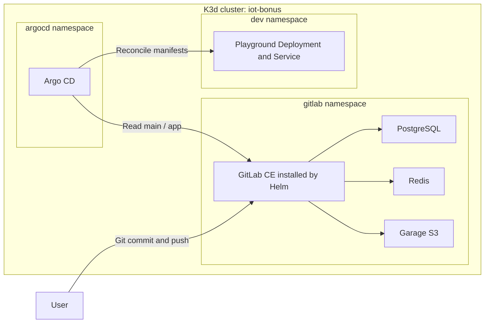

# Bonus implementation: what to explain in the defense

The bonus demonstrates this chain:

**Commit an image change in local GitLab → Argo CD detects it → Kubernetes rolls
out the requested application version.**

The source of truth for assignment requirements is
[PROJECT_SUBJECT.md](../PROJECT_SUBJECT.md). [README.md](README.md) contains the
commands to reproduce and demonstrate the lab.

## 1. The reduced file layout

```text
bonus/
├── scripts/
│   ├── install.sh
│   ├── setup.sh
│   └── access.sh
├── confs/
│   ├── gitlab-values.yaml
│   ├── dependencies.yaml
│   ├── application.yaml
│   └── app/
│       └── manifests.yaml
├── README.md
└── IMPLEMENTATION.md
```

There are **three shell scripts and four YAML files**. Python scripts, token/API
automation, a common shell library, version-change and verification scripts,
and custom Argo CD polling configuration have been removed.

| File | Responsibility |
| --- | --- |
| `install.sh` | Install host tools and configure the local GitLab hostname |
| `setup.sh` | Create the cluster and install dependencies, GitLab, and Argo CD |
| `access.sh` | Display initial passwords and forward the Argo CD interface |
| `gitlab-values.yaml` | Override the official GitLab Helm chart's defaults |
| `dependencies.yaml` | Provide local PostgreSQL, Redis, and S3-compatible storage |
| `application.yaml` | Tell Argo CD which GitLab repository/path to deploy |
| `app/manifests.yaml` | Define the playground Deployment and Service |

Repository creation uses GitLab's web interface. Version changes use the GitLab
editor or normal `git add`, `git commit`, and `git push`. These are visible steps
you can explain and demonstrate directly.

## 2. Architecture and ownership



The project VM runs Docker. K3d creates a K3s Kubernetes node inside Docker.
Namespaces separate resource names and responsibilities inside that same cluster;
they are not separate machines. All bonus commands select context `k3d-iot-bonus`.

Helm manages GitLab's chart resources. `kubectl` installs the separate dependencies
and Argo CD. After registration, Argo CD manages the playground resources from
Git. GitLab infrastructure itself is not managed by this Argo CD Application.

## 3. Why Helm and these dependencies remain

A Helm **chart** is a package of Kubernetes templates. A **values file** supplies
overrides. A **release** is an installed instance of a chart. Here the chart is
`gitlab/gitlab`, the release is `gitlab`, and our settings are in
`confs/gitlab-values.yaml`.

`helm upgrade --install` creates or updates that release. Setup resolves the latest
stable chart on a fresh installation and uses the installed release's chart version
on reruns. The validated chart in the earlier implementation was `10.5.1`, which
packages GitLab `19.5.1`; chart and application versions are different identifiers.

The current official GitLab chart requires external PostgreSQL, Redis, and object
storage. Our dependencies are external to that chart but still local to the same
cluster. These services are necessary for this installation, not extra deployment
automation. See [GitLab's chart deployment documentation](https://docs.gitlab.com/charts/installation/deployment/).

| Component | Stores or does what? |
| --- | --- |
| GitLab webservice / Workhorse | Web UI, API, and Git HTTP requests |
| Gitaly, included in the chart | Git repositories |
| Sidekiq, included in the chart | Background jobs |
| PostgreSQL | Users, projects, and relational application metadata |
| Redis | Cache and background-work coordination |
| Garage | Objects for configured file features such as uploads, artifacts, and LFS |

The values file selects Community Edition, HTTP access through K3s Traefik, one
webservice replica, one Sidekiq replica, and a persistent Gitaly volume. Optional
registry, runner, KAS, SSH shell, toolbox, monitoring, and certificate services are disabled.
The application image comes from Docker Hub, and Argo CD deploys it without a
GitLab CI runner.

## 4. State and credentials

`dependencies.yaml` contains one StatefulSet and Service per backend, plus Garage's
configuration. StatefulSets give the backends stable Pod identities and persistent
volume claims. Services provide stable network names despite changing Pod IPs.

| Backend | Image | Volume request | Important setting |
| --- | --- | --- | --- |
| PostgreSQL | `postgres:17-bookworm` | 8 GiB | `max_locks_per_transaction=512`, `max_connections=200` |
| Redis | `redis:7.2-bookworm` | 1 GiB | Authentication and append-only persistence |
| Garage | `dxflrs/garage:v2.4.1` | 8 GiB | Single-node S3 on port 3900 |
| Gitaly, chart-managed | Selected by chart | 10 GiB | Git repository persistence |

PostgreSQL's lock setting supports GitLab's large initial schema load. Backend
readiness checks only establish that each service is available; GitLab's migration
Job must still initialize the database before the application becomes usable.

Garage supplies an S3 API locally; it does not require an AWS account. Setup creates
the four buckets for LFS, artifacts, uploads, and packages, and grants the GitLab
key permissions. No backup automation is configured.

Setup uses OpenSSL to generate separate backend passwords and S3/RPC secrets,
stored together in **`gitlab/gitlab-dependencies`**. The same Secret also contains
GitLab's S3 connection YAML. Existing Secret
contents are retained on reruns. Secrets are referenced by the values file and
dependency Pods; they are not written into Git.

Kubernetes Secret data is base64-encoded, which is not encryption. The initial
GitLab and Argo CD administrator passwords are generated by their installations
and read by `access.sh`; that script does not reset changed passwords.

The K3s local-path provisioner supplies these volumes on the node. Pod restarts
and cluster stops retain data. Deleting the cluster removes its node-local data,
including later GitLab commits that are not present in this repository's seed file.

## 5. What setup does, in order

1. Check tools and Docker access.
2. Create or start `iot-bonus`, including the required host-port mappings.
3. Create `gitlab`, `argocd`, and `dev` namespaces.
4. Create dependency credentials only if their Secret is absent.
5. Apply dependency manifests and wait for their readiness.
6. Create any missing S3 buckets and grant permissions.
7. Install GitLab with the official Helm chart, waiting for resources and Jobs.
8. Install the pinned Argo CD `v3.5.6` manifests and wait for core components.

It then finishes. You create the public `root/iot-playground` project in the GitLab
UI, push the `app/` manifests on `main`, and apply `confs/application.yaml`.
This explicit handoff replaces the previous application-specific Python code.

## 6. How network access works

| Caller | Address / path |
| --- | --- |
| Browser → GitLab | `http://gitlab.iot.test` → VM loopback port 80 → K3d → Traefik → GitLab Workhorse |
| Argo CD → GitLab | `http://gitlab-webservice-default.gitlab.svc.cluster.local:8181/root/iot-playground.git` |
| Browser → Argo CD | `https://localhost:8080` → active kubectl port forward → Argo CD Service port 443 |
| Client → playground | `http://localhost:8888` → K3d → node port 30088 → Service → application port 8888 |

`gitlab.iot.test` needs a hosts-file entry on the browser's machine. The Host
header lets Traefik select GitLab's ingress rule. Internal Kubernetes Service DNS
is separate; Argo CD does not depend on the browser's hosts file.

`localhost` inside a Pod refers to that Pod, not the VM or a different Pod. This
is why the Application uses GitLab's internal Service hostname. That repository
is public, so Argo CD needs no GitLab token.

Argo CD has no permanent host mapping: `access.sh` keeps a port-forward process
running. Closing it closes the interface. A browser outside the project VM needs
SSH forwarding and the appropriate hostname mapping on its own machine.

## 7. The GitOps loop

`confs/application.yaml` creates an Argo CD **Application**, a custom Kubernetes
resource supported by the CRD installed with Argo CD. It lives in `argocd`, while
its destination workloads live in `dev`.

| Field | Meaning |
| --- | --- |
| `repoURL` | Local GitLab repository through internal DNS |
| `targetRevision: main` | Track the repository's `main` branch |
| `path: app` | Read manifests from the repository's `app/` directory |
| Destination server | The same Kubernetes cluster |
| Destination namespace | `dev` |
| Automated sync | Apply detected Git changes automatically |
| `prune: true` | Remove managed resources removed from desired manifests |
| `selfHeal: true` | Reconcile manual drift in managed live configuration |

The repo-server fetches manifests; the application-controller compares desired
and live resources and reconciles them; the Argo CD server provides the UI/API.
Default polling detects commits without a webhook or custom timer configuration.
See [Argo CD automated sync](https://argo-cd.readthedocs.io/en/stable/user-guide/auto_sync/).

**Synced** means the managed configuration matches the desired revision.
**Healthy** means the workloads satisfy Argo CD's health assessment. A newly
updated Deployment can be Synced while its new Pod is still starting.

The image version is changed in Git and committed/pushed. This is continuous
deployment of already-built images; this lab does not build images or run a
continuous-integration test pipeline.

## 8. Deployment, Service, and ReplicaSets

`app/manifests.yaml` contains two YAML documents separated by `---`:

- A Deployment requesting one `wil42/playground:v1` Pod, with an HTTP readiness
  probe on port 8888.
- A NodePort Service selecting `app: playground`, with Service/target port 8888
  and node port 30088.

Changing the image to v2 changes the Deployment's Pod template. Kubernetes rolls
out a Pod for the new template, checks readiness, and scales down the old
ReplicaSet. Old ReplicaSets may remain at zero replicas for rollback history.
Returning to an identical v1 template can reuse its retained ReplicaSet. Two
ReplicaSet objects therefore do not imply two running application copies.

An image tag (`v1`), a Git commit SHA, a Deployment revision, a ReplicaSet hash,
and a Helm release revision identify different things. For the demonstration,
compare the GitLab commit with Argo CD's synchronized SHA, then check the
Deployment image and `curl http://localhost:8888/` response.

To roll back while preserving GitOps, commit a return to v1. A manual live image
change can be reversed by self-healing while Git still requests another image.

## 9. A short defense explanation

“I create a K3s cluster with K3d inside the project VM. I install GitLab CE through
Helm and supply its required persistent PostgreSQL, Redis, and S3 services.
GitLab runs in its own namespace. I create a public GitLab repository containing
the application's Kubernetes manifests. Argo CD tracks its main branch and
deploys into dev. When I commit an image change from v1 to v2, Argo CD detects
the commit and Kubernetes rolls out the new version. I verify the synchronized
commit, workload health, and HTTP response.”

The subject permits the tools used here; the separate cluster, backend choices,
and manual Git workflow are implementation decisions. This is a single-node HTTP
lab with local storage. The mandatory parts must work correctly before the bonus
is evaluated.
