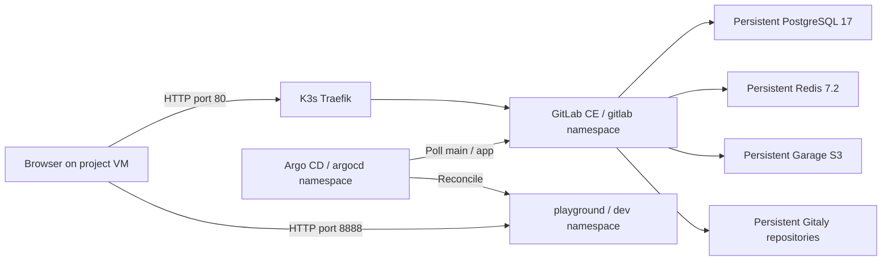

# Bonus: local GitLab with Helm and Argo CD

This lab reproduces Part 3 with a repository hosted in local GitLab. The official
`gitlab/gitlab` Helm chart installs GitLab CE in the `gitlab` namespace. Argo CD
watches a public GitLab repository and automatically deploys its application into
`dev`. Changing the image in GitLab from `v1` to `v2` updates the running application.

The bonus uses a separate K3d cluster, **`iot-bonus-helm`**, containing `gitlab`,
`argocd`, and `dev`. Scripts always specify its context, `k3d-iot-bonus-helm`.
Part 3's `iot` cluster and GitHub configuration are independent.



## Prepare the VM

Use a Debian/Ubuntu Linux **virtual machine**, as required by the subject. Plan
for **16 GiB RAM, 8 vCPUs, and 40 GiB free disk** for this single-node lab. Image
downloads and first database migrations can take 20–30 minutes. Stop other large
labs if the VM runs out of memory. Ports **80** and **8888** must be available;
port **8080** is used when opening the Argo CD UI.

Run from the repository root:

```sh
sudo bash bonus/scripts/install.sh
# Log out and back in if Docker group membership was just added.
docker info
bash bonus/scripts/setup.sh
```

`install.sh` reuses Part 3's prerequisite installer, installs Helm 4 with checksum
verification, matches kubectl to K3d's Kubernetes version, and adds
`127.0.0.1 gitlab.iot.test` to the VM's `/etc/hosts` if absent. Run `setup.sh` as your
normal user, without sudo, so the cluster kubeconfig belongs to that user.

`setup.sh` creates the cluster with loopback port mappings, creates namespaces and
random credentials, starts the persistent dependencies, installs GitLab via Helm,
installs Argo CD, creates the public `root/iot-playground` project, commits the
initial `app/` manifests, and registers the Argo CD Application. It waits until the
application is healthy and responds with `v1` (or the current version on a rerun).

For a fresh installation, the script selects the **latest stable official GitLab
chart** using `helm repo update` and `helm search repo`. It records that chart and
the resolved Argo CD release in `gitlab/bonus-versions` so a rerun uses the same
versions. The values were rendered and linted against **chart 10.5.1 / GitLab
19.5.1** on 2026-10-25. An explicit version can be selected for a fresh cluster:

```sh
GITLAB_CHART_VERSION=10.5.1 bash bonus/scripts/setup.sh
```

The chart version differs from the GitLab application version. See the official
[version mappings](https://docs.gitlab.com/charts/installation/version_mappings/).
Chart 10.x requires external database, Redis and object storage; the manifests in
`confs/dependencies.yaml` supply these **locally inside the cluster**, separately
from the GitLab Helm release. See GitLab's
[deployment documentation](https://docs.gitlab.com/charts/installation/deployment/).
The local S3 service uses the official `dxflrs/garage:v2.4.1` image and its
[single-node bootstrap mode](https://garagehq.deuxfleurs.fr/documentation/quick-start/).
Its keys and RPC secret are generated once in Kubernetes Secrets; setup creates
the buckets GitLab needs and grants the application key access.
PostgreSQL uses `max_locks_per_transaction=512` so GitLab's initial schema can
load its thousands of tables and indexes in one transaction.

## Open the applications

```sh
bash bonus/scripts/access.sh
```

This prints the initial GitLab `root` and Argo CD `admin` passwords from Kubernetes
Secrets, then forwards the Argo CD service until Ctrl-C.

| Application | URL |
| --- | --- |
| GitLab | <http://gitlab.iot.test> |
| GitLab repository | <http://gitlab.iot.test/root/iot-playground> |
| Argo CD | <https://localhost:8080> (accept its local certificate) |
| Playground | <http://localhost:8888> |

These addresses refer to the **project VM**. For a browser on another computer,
forward the VM's loopback ports over SSH and add the GitLab host entry on that
computer. For example, local ports 8081 and 8889 can forward VM ports 80 and 8888
if the standard local ports are occupied, but GitLab links expect its canonical
port 80; use local port 80 when browsing GitLab normally.

The Argo CD repository URL uses
`gitlab-webservice-default.gitlab.svc.cluster.local:8181`, not the VM loopback.
Anonymous HTTP cloning works because the project is public; Argo CD needs no
GitLab token or DNS changes. `http://localhost:8888` uses K3d's mapping to the
application's NodePort 30088. GitLab's chart-provided services remain internal
except for the HTTP ingress.

## Demonstrate continuous deployment

```sh
curl http://localhost:8888/
# {"status":"ok", "message":"v1"}

bash bonus/scripts/set-version.sh v2
curl http://localhost:8888/
# {"status":"ok", "message":"v2"}

# Optional: demonstrate the reverse change.
bash bonus/scripts/set-version.sh v1
```

`set-version.sh` creates a **Git commit in the local GitLab repository** through
the GitLab commits API. It never patches the live Deployment or forces an Argo CD
sync. Argo CD's regular polling discovers the commit and performs the deployment;
the lab sets polling to 30 seconds. The script allows up to ten minutes and verifies
the expected HTTP response.
Verification also requires Argo CD's synchronized revision to equal the GitLab
`main` commit, so an older healthy deployment cannot pass the check.
Automation obtains an expiring API token through the chart's toolbox Rails runner,
keeps it in memory, and revokes it when finished. No credentials are stored in Git.

You can instead sign into GitLab, edit `app/deployment.yaml` on `main`, change
`wil42/playground:v1` to `wil42/playground:v2`, and commit it in the UI. Then run:

```sh
bash bonus/scripts/verify.sh v2
```

Editing `bonus/confs/app/deployment.yaml` on disk after setup does **not** update
the local GitLab repository: those files are initial seed manifests. Later changes
must be committed in GitLab. A setup rerun preserves the existing `main` branch,
including any v2 demonstration commit.

Show these during evaluation:

```sh
kubectl --context k3d-iot-bonus-helm get namespaces
helm --kube-context k3d-iot-bonus-helm -n gitlab list
kubectl --context k3d-iot-bonus-helm -n gitlab get pods,pvc,ingress
kubectl --context k3d-iot-bonus-helm -n argocd get application playground -o yaml
kubectl --context k3d-iot-bonus-helm -n dev get deployment,pods,service
```

Also show GitLab's commit history and Argo CD's synchronized revision before and
after changing the version. The subject evaluates the bonus only after the
mandatory parts work flawlessly.

## Repeat runs and troubleshooting

Rerun `setup.sh` after a recoverable failure. It retains credentials, PVC data,
release versions, and existing repository commits. The cluster must have been
created by this script with its required port mappings. `CLUSTER_NAME` can select
a different **fresh** cluster name, but the host ports are fixed and only one such
cluster can bind them at a time. Pass the same variable to all entry points.

```sh
kubectl --context k3d-iot-bonus-helm -n gitlab get pods,pvc,jobs
kubectl --context k3d-iot-bonus-helm -n gitlab get events --sort-by=.lastTimestamp
kubectl --context k3d-iot-bonus-helm -n gitlab logs deployment/gitlab-webservice-default -c webservice --tail=80
kubectl --context k3d-iot-bonus-helm -n argocd logs deployment/argocd-repo-server --tail=80
curl --resolve gitlab.iot.test:80:127.0.0.1 http://gitlab.iot.test/-/readiness
```

Pending PVCs require the default K3s local-path provisioner. Pending pods or
OOMKilled containers usually indicate insufficient memory. ImagePullBackOff
requires checking registry access from the VM and K3d node. A GitLab readiness
failure can also mean migrations or first startup are still running. If a bootstrap
API operation fails, resolve the reported cause and rerun setup; an already-created
empty project can be seeded on the next run.

This is an HTTP, single-replica lab with optional services (SSH shell, registry, runner, KAS,
Prometheus and cert-manager) disabled. PostgreSQL, Redis, Garage and Gitaly keep data
in PVCs across pod restarts and cluster stops. Deleting the K3d cluster removes its
node-local data. Back up important data before deletion or a version upgrade;
GitLab upgrades must follow its supported upgrade path. Setup refuses to silently
change the recorded GitLab chart version.

To release resources while retaining the lab:

```sh
k3d cluster stop iot-bonus-helm
```

Start it again by rerunning setup. No cleanup command is run automatically.

## Validation record

Validated locally on 2026-10-25 with GitLab chart **10.5.1 / GitLab CE 19.5.1**,
Argo CD **3.5.6**, and K3s **1.35.5**:

- Helm rendering/lint, shell/Python syntax, and YAML parsing passed.
- Initial GitLab commit `c625a518` deployed `v1` automatically.
- GitLab commit `a9490f51` deployed `v2`; Argo CD reported that exact revision and
  the HTTP endpoint returned `v2`.
- A complete setup rerun retained `a9490f51`, `v2`, and all four existing PVCs.
- GitLab commit `057ff6ce` deployed `v1` again; the cluster was left healthy on `v1`.
- Automation edge checks covered preserving existing branches, avoiding duplicate
  version commits, rejecting ambiguous image edits, commit concurrency protection,
  and token revocation on failure.

The prerequisite installer was syntax-checked; live testing used the existing
Docker/K3d/kubectl tools and a temporary Helm binary rather than reinstalling the
VM's packages. On a fresh VM, run `install.sh` before `setup.sh` as shown above.
